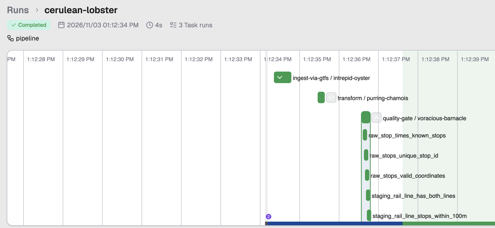
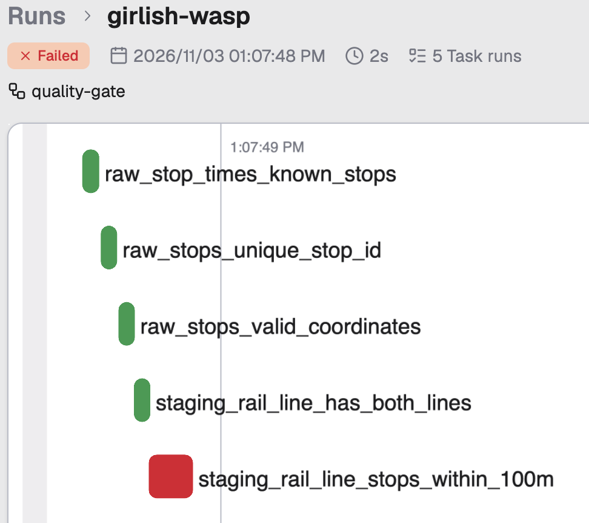
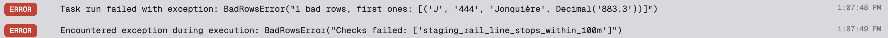

# quebec-train-to-trail

[](https://github.com/rysyt/quebec-train-to-trail/actions/workflows/data-tests.yml)

A tool for planning hikes in northern Québec that start from a VIA Rail stop. It will answer questions like "which trails of at least 10 km start within 3 km of a stop?" (arbitrary numbers for now) and illustrate the answers with a map.

**Status:** in progress. VIA Rail's GTFS feed and the OpenStreetMap ways and places within 20 km of the two train lines load into PostGIS, the lines and their stops are built, and a data-quality gate checks every run (slice 5 of 9).

**Stack:** Python, Prefect, Apache Spark with Apache Sedona, PostgreSQL with PostGIS, SQL, Docker Compose, uv, pytest, Ruff, SQLFluff, pre-commit, GitHub Actions.

## Run it locally

Needs [Docker Desktop](https://www.docker.com/products/docker-desktop/) and [uv](https://docs.astral.sh/uv/getting-started/installation/).

```
cp .env.example .env     # then set your own password in .env
docker compose up -d     # start PostGIS in the background
docker compose exec db psql -U train_to_trail -d train_to_trail
```

In `psql`, `SELECT postgis_full_version();` should answer. The database listens on `localhost:5432` only. Stop it with `docker compose down`; your data is kept.

Run the whole pipeline (uv installs Python 3.13 and the dependencies on first run):

```
uv sync
uv run --env-file .env python -m quebec_train_to_trail.pipeline
```

It ends with `Finished in state Completed()` when every step and check passed. The first run downloads OpenStreetMap's Québec extract (1.2 GB) and Sedona's Spark jars; the OpenStreetMap step then takes about 10 minutes and needs Java 17. Each step can also run on its own:

```
uv run --env-file .env python -m quebec_train_to_trail.ingest.via_gtfs     # GTFS only
uv run --env-file .env python -m quebec_train_to_trail.ingest.osm          # OpenStreetMap only
uv run --env-file .env python -m quebec_train_to_trail.transform.run_sql   # transform only
```

### Or run it in Docker

The pipeline image has Python, Java and every dependency, so nothing else needs installing:

```
docker compose build pipeline     # once, and after code changes
docker compose run --rm pipeline
```

Downloads go to `raw/` on your machine, so a rerun reuses them.

## The pipeline

The pipeline is a [Prefect](https://docs.prefect.io/) flow. A flow is the whole job; each step inside it is a task, and Prefect logs, times and retries every task on its own. `pipeline` runs four smaller flows in order:

1. **Ingest GTFS** (`ingest-via-gtfs`). Downloads the GTFS feed to `raw/viarail.zip` once, then loads every file in it into its own table (`stops.txt` becomes `raw.stops`). A rerun reuses the saved zip.
2. **Ingest OpenStreetMap** (`ingest-osm`). Downloads Geofabrik's Québec extract to `raw/` once and checks its MD5 sum. Spark, with Apache Sedona for the spatial functions, then reads the 1.2 GB file and keeps what lies within 20 km of the two lines. It filters before it joins: first the points inside the corridor, then the ways that touch one of them, and only then are those ways joined to their points to build lines. The result goes to `raw.osm_ways` (every road and path, about 570,000), `raw.osm_places` (places to sleep and eat, shelters, toilets and towns, about 12,000) and `raw.osm_hiking_routes` (51 named hiking routes), with their OpenStreetMap tags. Which of them count as trails is decided later, in SQL.
3. **Transform** (`transform`). Runs the SQL files in `db/transform/` in number order (`01_rail_line.sql`, then `02_...`). Each file runs in its own transaction, so a file that fails leaves `staging` as it was and stops the run. `01_rail_line.sql` builds `staging.rail_line`: the Jonquière and Senneterre lines as geometry in EPSG:32198, in metres. `02_stop.sql` builds `staging.stop`, the 91 stops on those lines, and `staging.stop_line`, which pairs each stop with its line or lines (the stops from Montréal to Hervey are on both). Every geometry column gets a GiST index, so distance queries skip far-away shapes.
4. **Quality gate** (`quality-gate`). Runs every check in `tests/sql/` as its own task. A check is a query that returns the rows breaking a rule, so no rows means it passed. Every check runs, then the pipeline fails if any of them found bad rows.



**Why the gate.** A step can finish without errors and still produce wrong data: a station in the wrong place, a line missing after the source renumbers its shapes. The gate stops the run there, so wrong data never reaches `analytics` or the map, and it logs the rows that broke the rule. Here a station was moved 1 km off its line on purpose; the check that every stop is within 100 m of its line catches it:





### Watch it in the dashboard

Prefect comes with a local web dashboard that shows each run as a graph like the ones above. Start it in one terminal and leave it running:

```
uv run prefect server start
```

Then run the pipeline in a second terminal, pointed at that server (without `PREFECT_API_URL`, Prefect starts a temporary server that disappears when the run ends):

```
PREFECT_API_URL=http://127.0.0.1:4200/api uv run --env-file .env python -m quebec_train_to_trail.pipeline
```

Open http://127.0.0.1:4200, go to **Runs** and click the `pipeline` run. Expand a step in the graph to see its tasks; click a task to read its logs.

## Sources

- **VIA Rail GTFS**: schedules, stops and track shapes for the Montréal to Senneterre and Montréal to Jonquière lines. Contains information licensed under the [Open Government Licence – Canada](https://open.canada.ca/en/open-government-licence-canada). A snapshot is committed in `tests/data/` as test data.
- **OpenStreetMap**, via [Geofabrik](https://download.geofabrik.de/north-america/canada/quebec.html): roads, paths, hiking routes, places to stay and eat. © OpenStreetMap contributors, available under the [Open Database License](https://www.openstreetmap.org/copyright). A small cut around Hervey-Jonction is committed in `tests/data/` as test data.
- **Natural Resources Canada MRDEM-30**: a 30 m elevation model.

## Steps

1. **Collect.** Python flows run by Prefect download each source into `raw/`. Downloads stay on the local machine and are not committed. A rerun reuses them instead of downloading again.
2. **Load.** PostGIS runs in Docker Compose, with three schemas: `raw`, `staging` and `analytics`.
3. **Clean.** SQL files run in order. They reproject everything to EPSG:32198 (NAD83 / Québec Lambert), fix invalid geometry, remove duplicates, and join trail segments into whole trails with their lengths. Elevation is only cut to a corridor around the two lines and reprojected.
4. **Ask.** SQL queries in `analytics` answer the hike questions, for example trails of at least a given length within a given distance of a stop. Later: remote, hilly trails with somewhere to sleep and eat nearby.
5. **Map.** A QGIS project, saved as a plain `.qgs` file in the repo, shows the results on a 2D map and the train's route in 3D on the elevation data.

## Checks

Before each commit, [pre-commit](https://pre-commit.com/) checks formatting, YAML and TOML, file sizes and private keys, lints and formats Python with Ruff and SQL with SQLFluff, and keeps `uv.lock` in step. Turn it on once per clone with `uv run pre-commit install`.

On every push, GitHub Actions starts PostGIS, runs the whole pipeline on the committed snapshots (the GTFS feed and the Hervey-Jonction OpenStreetMap cut in `tests/data/`), and then runs pytest. The tests check that each `raw` table has as many rows as its file, and run the SQL checks in `tests/sql/`: each returns the rows that break it, so an empty result passes. Later steps will add checks for row counts between steps and valid geometry. A pull request can merge into `main` only when this check passes.

Run the same tests locally, after running the pipeline:

```
uv run --env-file .env pytest
```

## Roadmap

- **v1**: everything above, end to end, with a 3D render of the route.
- **v2**: places to stay with prices, then terrain analysis (ruggedness).

## Design decisions

See [docs/adr/](docs/adr/).
